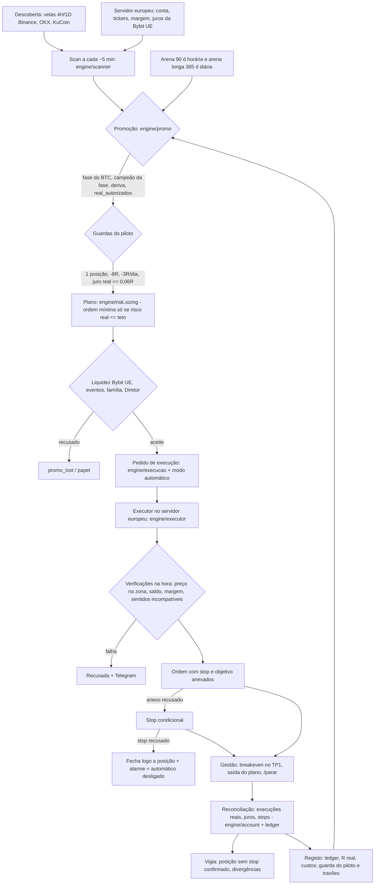

# CryptoScan — arquitetura e estado operacional (12/11/2026)

- Base: main d541a1c. Este documento vive no ramo `montagem-final`, que não está integrado.
- Sem valores da conta: o repositório é público.

## 1. Contas e mercados

| Corretora | Conta | Mercados usados | Instrumentos reais | Custos lidos na conta |
|---|---|---|---|---|
| Bybit UE (`api.bybit.eu`) | Conta Unificada, margem spot (teto 7x, efetiva 1x) | Spot USDC e Spot Margin | 108 pares USDC; 37 com short (todos emprestáveis) | 0,25% por lado (taker); juro de 0,0015 a 0,047% por dia; ordem mínima 5 USDC (BTC 1) |
| OKX EEA (`eea.okx.com`) | net_mode, margem isolada | X-Perps (FUTURES `*_XPERP`) | 263 contratos, long e short | taker 0,05%, maker 0,02%; funding real; contrato mínimo mediano 1,22 USD |

- A descoberta de sinais usa velas da Binance, OKX e KuCoin (967 moedas).
- A execução só usa instrumentos confirmados na corretora.

## 2. Estratégias e estado real

| Sentido | Estratégia | Corretora | Estado em produção | Evidência (resumo) |
|---|---|---|---|---|
| SHORT | **SHORT_TURTLE** (lateral) | Bybit UE margem | **REAL, piloto ativo** desde 12/11 01:40. Teto 4%, 1 posição, −8R, −3R/dia, juro ≤ 0,06R. 0 operações | Dois períodos e moedas fora do estudo positivos por dia; 1 operação real |
| LONG | **Núcleo BTC** (fecho diário > média de 50 dias; 100% do capital; margem 2x) | Bybit UE | **REAL, ligado** desde 01/11; hoje fora (BTC abaixo da média) | Réplica com custos a 1x: +28%/ano (2021–24) e +9%/ano (2024–26). A 2x: +36% e +6%, com quedas de −86% e −52% |
| LONG | H46 recuo RSI<30 | OKX | **REAL a 1%**, 0 sinais (BTC não está em subida) | Sem vantagem por dia com moedas retiradas |
| LONG | H40 pânico | OKX | Papel (real desligado a 10/11) | ~0R por dia; ordens limite de mercado não encheram |
| SHORT | TF-SHORT U2 | OKX | Papel; executor pronto no ramo `investigacao/universo-bybit-ue`, NÃO integrado | +0,15R/op histórico; últimos 6 meses −0,26R por dia; papel 0 fechadas |
| LONG/SHORT | Lutadores da arena (Bounce, DIP, TURTLE, SHORT_X30…) | Bybit UE | Papel (só SHORT_TURTLE está em `real_autorizados`) | Sem vantagem por dia independente |
| — | MACRO, FASES_LATERAL, H45 | — | Papel / suspensas | Negativas |

## 3. Fluxo do sinal ao fecho (Bybit UE)

- Na OKX o ciclo é o mesmo, com outros módulos: `tools/okx_agente.py` gera os sinais; `tools/okx_exec.py` coloca a ordem limite com stop e objetivo anexados, reconcilia, trata a caducidade e confirma os stops; `tools/publicar_estado.py` publica o estado.

## 4. Proteções

- **Duplicação:** identificador de ordem determinístico por operação (Bybit `orderLinkId`, OKX `clOrdId`); operação já aberta nunca repete.
- **Posição sem stop:** stop anexado → stop condicional → fecho imediato; alarme; o modo automático desliga-se; a vigia avisa.
- **Reinícios:** estado no ramo `data` (cifrado), reconciliação com as execuções reais; OKX com cópia local e recuperação.
- **Travões:** −3R por dia e −6R por semana; risco reduzido após perdas; guarda do piloto; travão de queda da OKX (45%).
- **Sentidos incompatíveis (novo, neste ramo):**
  - o short é recusado se a conta tem a moeda em carteira;
  - a compra é recusada se há short aberto na moeda.

## 5. Bloqueios reais

1. **Capital partilhado sem partição.** O Núcleo BTC usa 100% do capital com margem 2x. Quando entra, o piloto short fica sem margem e a carteira fica direcional a 2x.
2. **Sem LONG com vantagem por acontecimento.** O Núcleo ganha por poucas tendências grandes (7 de 26 entradas ganhadoras) e a 2x tem quedas históricas acima de 50%.
3. **TF-SHORT sem evidência recente,** e com o capital da OKX só cabem 3 de 11 contratos.
4. **Sem dados intradiários** (1h/15m) dos X-Perps da OKX.
5. **Frequência baixa do piloto:** cerca de 14 operações por ano, só em mercado lateral.
